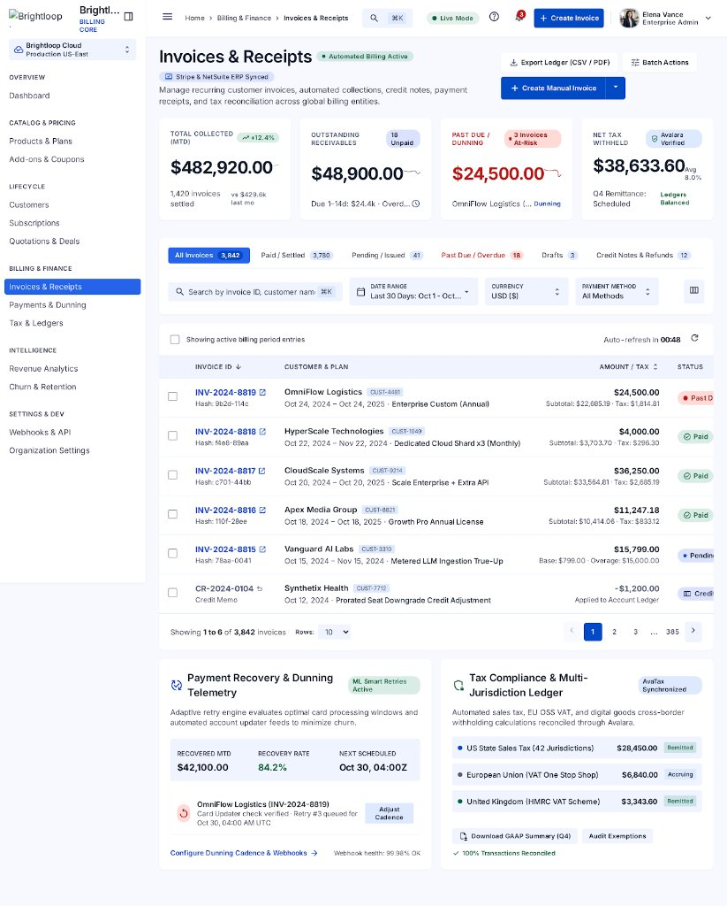
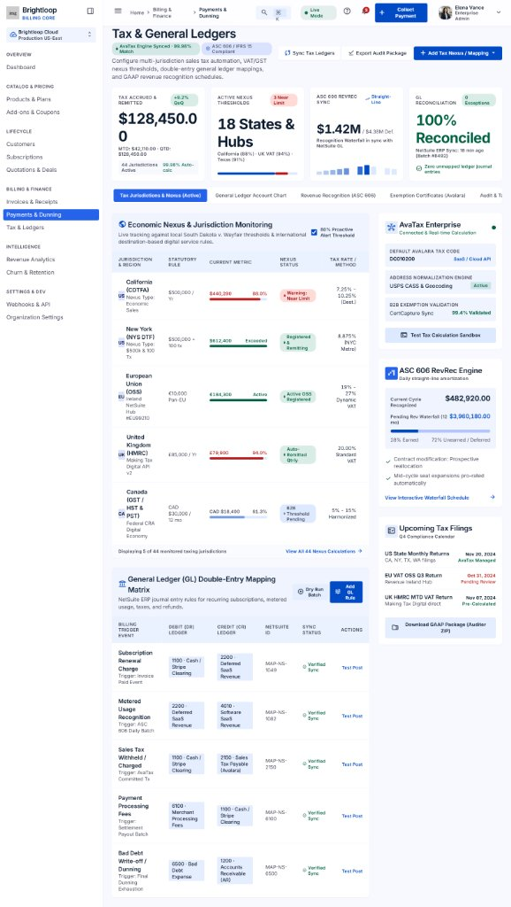
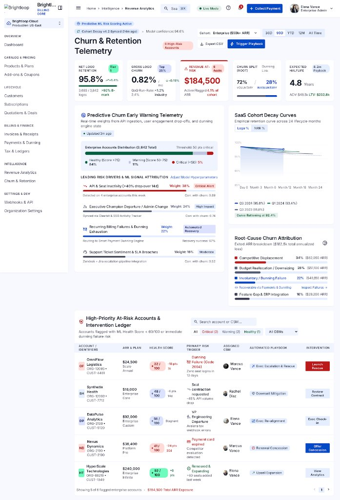
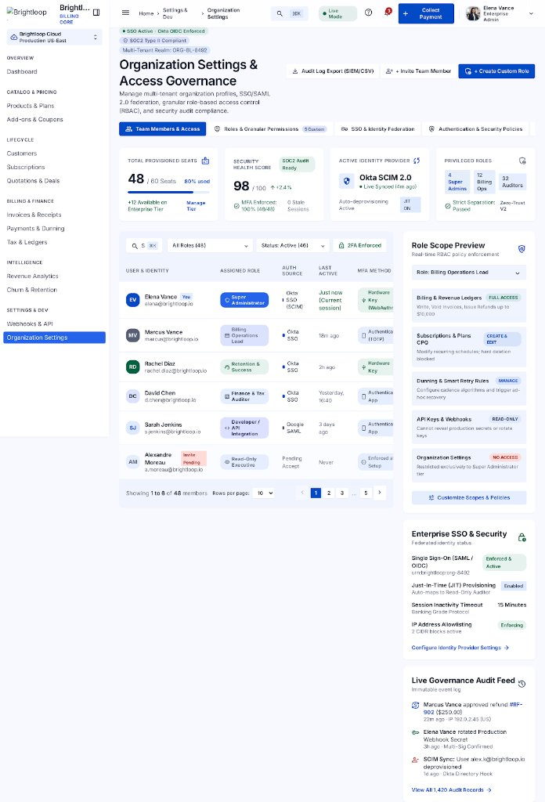

# Subscription-Management-System
> **Brightloop Enterprise Billing & Subscription Management Platform**

A production-grade, enterprise SaaS architecture designed for high-precision subscription lifecycle management, recurring revenue telemetry (MRR/ARR), plan tiering, automated collections, and billing automation.

---

## 📸 Previews

### 1. Executive Telemetry & Plans Dashboard


### 2. Customer 360 & Subscription Lifecycle View


### 3. Invoices, Receipts & Global Tax Reconciliation Ledger


### 4. Tax & General Ledgers / Payments & Dunning


### 5. Churn & Retention Telemetry / Revenue Analytics


### 6. Organization Settings & Access Governance


The complete design specification and design token standards are documented in [docs/DESIGN.md](docs/DESIGN.md), and the SPA frontend engineering architecture is detailed in [docs/FRONTEND_ARCHITECTURE.md](docs/FRONTEND_ARCHITECTURE.md).

---

## 🏗️ Project Architecture & Directory Structure

This repository follows industry-standard separation of concerns for modern multi-tier SaaS and Odoo enterprise modules:

```text
Subscription-Management-System/
├── docs/                                  # Product and Design Documentation
│   ├── DESIGN.md                          # UI/UX design system tokens, typography, and color palette
│   └── screenshots/                       # High-fidelity visual mockups and component previews
│       ├── dashboard-preview.png          # Main billing dashboard preview
│       ├── customer-detail-preview.jpg    # Customer 360 & dunning detail preview
│       └── invoices-receipts-preview.png  # Invoices & receipts ledger preview
├── frontend/                              # Frontend Web Application & Dashboard
│   ├── public/                            # Static assets
│   │   ├── index.html                     # Live dashboard prototype (code.html)
│   │   ├── customer-detail.html           # Live customer 360 & lifecycle detail prototype
│   │   └── invoices-receipts.html         # Live invoices & receipts ledger prototype
│   ├── src/                               # Modular UI components
│   │   ├── components/                    # Common, layout, and metrics components
│   │   ├── pages/                         # Overview, customer, and billing views
│   │   ├── styles/                        # CSS design tokens mapped from DESIGN.md
│   │   │   └── tokens.css
│   │   └── main.js
│   ├── index.html                         # Bundler entry point
│   ├── customer-detail.html
│   ├── invoices-receipts.html
│   └── package.json
├── backend/                               # REST API & Billing Microservice
│   ├── src/
│   │   ├── config/                        # Database & environment configurations
│   │   ├── controllers/                   # Request handlers (subscriptions, analytics)
│   │   ├── models/                        # Domain entities (Subscription, Customer, Plan, Invoice)
│   │   ├── routes/                        # Express API route declarations
│   │   ├── services/                      # Business logic (pricing calculator, MRR aggregator)
│   │   └── server.js                      # Application server entry point
│   ├── .env.example
│   └── package.json
├── static/                                # Odoo module static assets
│   └── description/                       # Odoo app description, views & screenshots
│       ├── index.html
│       ├── customer-detail.html
│       ├── invoices-receipts.html
│       ├── screen.png
│       ├── customer-detail-preview.jpg
│       └── invoices-receipts-preview.png
├── models/                                # Odoo ORM Models
├── views/                                 # Odoo XML Views
├── security/                              # Access control & record rules
├── controllers/                           # Odoo HTTP Controllers
├── code.html                              # Root standalone dashboard
├── customer-detail.html                   # Root standalone customer 360 view
├── invoices-receipts.html                 # Root standalone invoices & receipts view
├── DESIGN.md                              # Root design system documentation
├── screen.png                             # Root dashboard preview image
├── screen-customer.jpg                    # Root customer detail preview image
├── screen-invoices.png                    # Root invoices preview image
├── docker-compose.yml                     # Odoo container configuration
├── __manifest__.py                        # Odoo module manifest
├── .gitignore
└── README.md
```

---

## 🚀 Quick Start Guide

### 1. View the Interactive UI Prototypes
Open any interactive prototype directly in any modern browser or via live server:
- **Executive Dashboard:** [`code.html`](file:///c:/Users/offic/Desktop/Odoo/Subscription-Management-System/code.html) or `frontend/public/index.html`
- **Customer 360 Detail View:** [`customer-detail.html`](file:///c:/Users/offic/Desktop/Odoo/Subscription-Management-System/customer-detail.html) or `frontend/public/customer-detail.html`
- **Invoices & Receipts Ledger:** [`invoices-receipts.html`](file:///c:/Users/offic/Desktop/Odoo/Subscription-Management-System/invoices-receipts.html) or `frontend/public/invoices-receipts.html`
- **Tax & General Ledgers / Dunning:** [`tax-ledgers.html`](file:///c:/Users/offic/Desktop/Odoo/Subscription-Management-System/tax-ledgers.html) or `frontend/public/tax-ledgers.html`
- **Churn & Retention Telemetry:** [`churn-retention.html`](file:///c:/Users/offic/Desktop/Odoo/Subscription-Management-System/churn-retention.html) or `frontend/public/churn-retention.html`
- **Organization Settings & Governance:** [`organization-settings.html`](file:///c:/Users/offic/Desktop/Odoo/Subscription-Management-System/organization-settings.html) or `frontend/public/organization-settings.html`

### 2. Run the Backend API Service
```bash
cd backend
npm install
cp .env.example .env
npm run dev
```
