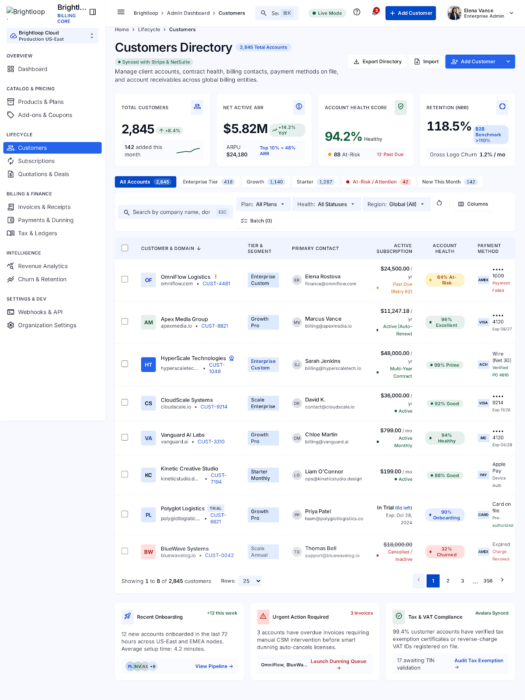
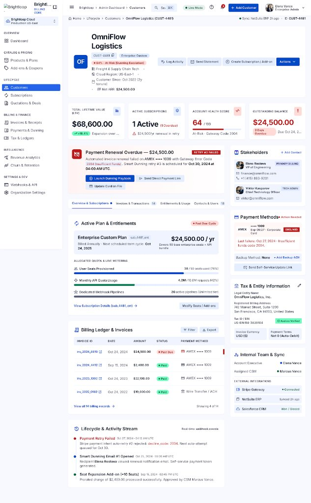
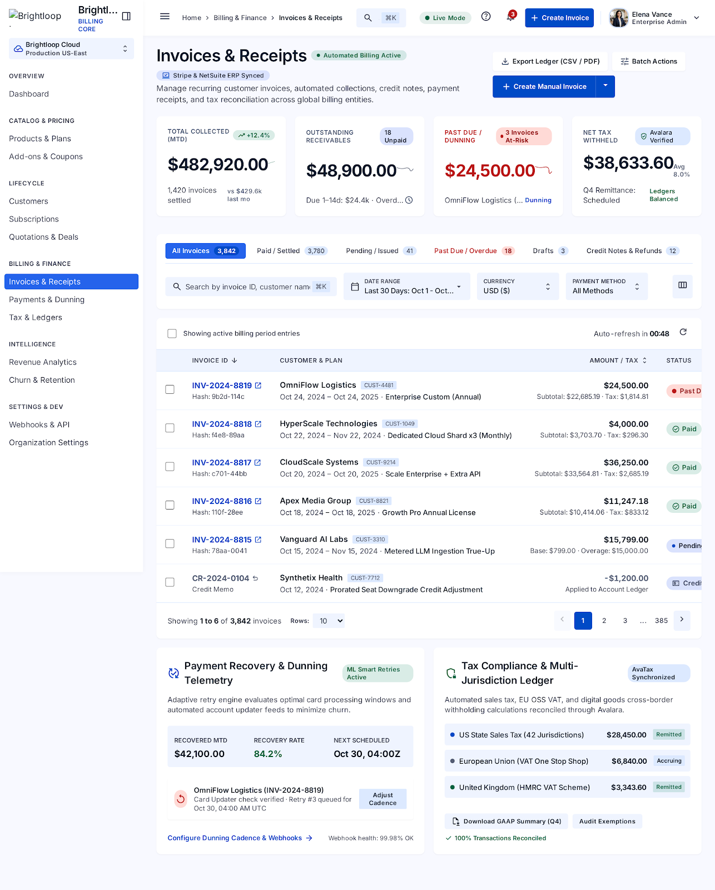

# Subscription Management

## Subscription plan frontend contract

The plan-management phase exposes these Odoo models:

- `subscription.plan`: `name` (char), `description` (text),
  `recurring_price` (monetary), `currency_id` (many2one `res.currency`),
  `billing_frequency` (selection), `minimum_quantity` (float),
  `available_from`/`available_until` (date), `automatic_closure`,
  `allow_early_closure`, `allow_pause`, `allow_renewal`, and `active` (boolean),
  and `line_ids` (one2many `subscription.plan.line`).
- `subscription.plan.line`: `plan_id` (many2one), `product_tmpl_id` (product
  reference), `product_id` (optional product variant), `minimum_quantity`
  (float), `unit_price` (monetary), `currency_id` (related currency),
  `tax_ids` (many2many `account.tax`), and `active` (boolean).

Use the exact billing-frequency values `daily`, `weekly`, `monthly`, and
`yearly`. Next billing dates use calendar arithmetic, so month ends and leap
days are preserved correctly.

Available actions are plan create, edit, activate, and archive for
`group_subscription_admin`. Staff can read available plans and use them on a
quotation line through `sale.order.line.subscription_plan_id`. Customers can
read only active plans within their availability dates. New quotation lines
must use an available plan, an active product line, and a quantity at least
the plan minimum. Expired and inactive plans are rejected.

The backend methods `is_available`, `validate_quantity`,
`get_next_billing_date`, `automatic_closure_applies`, `can_pause`,
`can_close_early`, and `can_renew` are the frontend's permission and
calculation contract. Invoice generation and subscription records are not part
of this phase.

## Subscription database contract

The database phase adds `subscription.subscription` and `subscription.line`.
Subscriptions use states `draft`, `quotation`, `confirmed`, `active`, `paused`,
and `closed`. Subscription numbers are generated as `SUB/YYYY/00001`.

The subscription contains `partner_id`, `plan_id`, `start_date`,
`expiry_date`, `next_invoice_date`, `payment_term_id`, `currency_id`, `state`,
`quotation_id`, `line_ids`, `invoice_ids`, `note`, `responsible_user_id`, and
the computed `amount_untaxed`, `amount_tax`, and `amount_total` fields.
Subscription lines contain `product_id`, `quantity`, `unit_price`, `tax_ids`,
`discount`, `currency_id`, `subtotal`, `tax_amount`, and `total`.

Subscription lines reuse `account.tax.compute_all`; no separate tax engine is
introduced. A subscription must have at least one active plan product, dates
must be ordered, currencies must match the plan, and line quantities/prices
must be valid. Customers can only read subscriptions belonging to their
commercial partner; staff can create and edit subscriptions, while
administrators have full access.

## Quotation management contract

Quotation management extends Odoo's native `sale.order`, `sale.order.line`,
and `sale.order.template` models. Quotations use the native `draft`, `sent`,
`sale`, and `cancel` states and retain Odoo's reference, totals, email, PDF,
and portal behavior.

The added quotation fields are `subscription_plan_id` (many2one
`subscription.plan`) and computed `quotation_expired` (boolean). Templates
add `applicable_plan_ids` (many2many `subscription.plan`). Use
`number_of_days` for template validity in Odoo 19.

Quotation validation checks plan availability, template plan restrictions,
plan product compatibility, minimum quantities, and validity dates. A line may
carry `subscription_plan_id` when the quotation-level plan is empty; if both
are set, they must match. Customer-facing `action_customer_accept` and
`action_customer_reject` actions are available for open quotations. Quotation
creation remains separate from subscription activation and conversion.

Accepted quotations (`sale.order.state = sale`) can be converted by subscription
staff or administrators with `action_convert_to_subscription()`. The action
creates exactly one linked `subscription.subscription`, copies customer,
plan, payment terms, currency, quotation dates, products, variants, quantities,
prices, discounts, and taxes, then advances the subscription through quotation
and confirmation lifecycle methods. It activates immediately when the selected
start date is today or earlier; future-start subscriptions remain confirmed.
The subscription stores `converted_at` and `converted_by_id` in addition to
the copied responsible sales user.

The conversion fields are `subscription_start_date`,
`subscription_expiry_date`, and readonly `subscription_id`. Conversion is
blocked for rejected, draft, sent, or expired quotations, and the unique
`subscription.quotation_id` constraint plus a savepoint prevents duplicate
conversions. Repeated conversion returns the existing subscription form action.

## Recurring billing contract

`subscription.subscription.cron_generate_recurring_invoices()` processes
active subscriptions whose `next_invoice_date` is due. It creates native
`account.move` customer invoices in draft state, with native invoice lines,
taxes, discounts, payment terms, and currency. Each invoice stores
`subscription_id`, `billing_period_start`, and `billing_period_end`, and the
subscription's next date advances only after successful creation.

The scheduled action `ir_cron_generate_recurring_invoices` runs daily in
batches of 100. Paused, closed, and expired subscriptions are excluded.
Calendar-aware plan billing dates determine each covered period. A database
unique constraint on `(subscription_id, billing_period_start,
billing_period_end)`, plus row locking with `SKIP LOCKED`, prevents duplicate
invoices when jobs overlap or retry. A failure is rolled back to its savepoint,
logged with the subscription number and ID, and does not stop other
subscriptions in the batch.

## Phases 11-16 backend contract

Invoices remain native `account.move` records. The addon adds
`subscription_overdue`, billing-period fields, subscription navigation, and
native payment-register actions; invoice posting, cancellation, email, PDF,
payment reconciliation, and payment states remain Odoo Accounting behavior.

Administrators manage `subscription.discount` rules. Supported fields include
`discount_type` (`fixed` or `percentage`), `value`, validity dates, usage
limits, product/plan scope, currency, and company. Applications are recorded
in `subscription.discount.application`, uniquely per discount and invoice.
Recurring billing applies one eligible rule per billing period, reserves usage
under a database row lock, and rolls back both invoice and usage on failure.

Customer portal routes are `/my/subscriptions`, `/my/subscription/<id>`,
`/my/invoices`, `/my/invoice/<id>`, `/my/invoice/<id>/pdf`, `/my/payments`,
and `/my/quotations`. Each route validates commercial-partner ownership on the
server. Admin/Staff dashboard consumers can call
`subscription.subscription.get_dashboard_kpis()`,
`get_recurring_revenue_metrics()`, `get_revenue_report()`, and
`get_plan_distribution()`; collected revenue uses paid native payments, while
MRR normalizes daily, weekly, monthly, and yearly plan prices.
> **Brightloop Enterprise Billing & Subscription Management Platform**

A production-grade, enterprise SaaS architecture designed for high-precision subscription lifecycle management, recurring revenue telemetry (MRR/ARR), plan tiering, automated collections, and billing automation.

---

## 📸 Previews

### 1. Executive Telemetry & Plans Dashboard


### 2. Customer 360 & Subscription Lifecycle View


### 3. Invoices, Receipts & Global Tax Reconciliation Ledger


The complete design specification and design token standards are documented in [docs/DESIGN.md](docs/DESIGN.md).

---

## 🏗️ Project Architecture & Directory Structure

This repository follows industry-standard separation of concerns for modern multi-tier SaaS and Odoo enterprise modules:

```text
Subscription-Management-System/
├── docs/                                  # Product and Design Documentation
│   ├── DESIGN.md                          # UI/UX design system tokens, typography, and color palette
│   └── screenshots/                       # High-fidelity visual mockups and component previews
│       ├── dashboard-preview.png          # Main billing dashboard preview
│       ├── customer-detail-preview.jpg    # Customer 360 & dunning detail preview
│       └── invoices-receipts-preview.png  # Invoices & receipts ledger preview
├── frontend/                              # Frontend Web Application & Dashboard
│   ├── public/                            # Static assets
│   │   ├── index.html                     # Live dashboard prototype (code.html)
│   │   ├── customer-detail.html           # Live customer 360 & lifecycle detail prototype
│   │   └── invoices-receipts.html         # Live invoices & receipts ledger prototype
│   ├── src/                               # Modular UI components
│   │   ├── components/                    # Common, layout, and metrics components
│   │   ├── pages/                         # Overview, customer, and billing views
│   │   ├── styles/                        # CSS design tokens mapped from DESIGN.md
│   │   │   └── tokens.css
│   │   └── main.js
│   ├── index.html                         # Bundler entry point
│   ├── customer-detail.html
│   ├── invoices-receipts.html
│   └── package.json
├── backend/                               # REST API & Billing Microservice
│   ├── src/
│   │   ├── config/                        # Database & environment configurations
│   │   ├── controllers/                   # Request handlers (subscriptions, analytics)
│   │   ├── models/                        # Domain entities (Subscription, Customer, Plan, Invoice)
│   │   ├── routes/                        # Express API route declarations
│   │   ├── services/                      # Business logic (pricing calculator, MRR aggregator)
│   │   └── server.js                      # Application server entry point
│   ├── .env.example
│   └── package.json
├── static/                                # Odoo module static assets
│   └── description/                       # Odoo app description, views & screenshots
│       ├── index.html
│       ├── customer-detail.html
│       ├── invoices-receipts.html
│       ├── screen.png
│       ├── customer-detail-preview.jpg
│       └── invoices-receipts-preview.png
├── models/                                # Odoo ORM Models
├── views/                                 # Odoo XML Views
├── security/                              # Access control & record rules
├── controllers/                           # Odoo HTTP Controllers
├── code.html                              # Root standalone dashboard
├── customer-detail.html                   # Root standalone customer 360 view
├── invoices-receipts.html                 # Root standalone invoices & receipts view
├── DESIGN.md                              # Root design system documentation
├── screen.png                             # Root dashboard preview image
├── screen-customer.jpg                    # Root customer detail preview image
├── screen-invoices.png                    # Root invoices preview image
├── docker-compose.yml                     # Odoo container configuration
├── __manifest__.py                        # Odoo module manifest
├── .gitignore
└── README.md
```

---

## 🚀 Quick Start Guide

### 1. View the Interactive Dashboard UI
Open any interactive prototype directly in any modern browser:
- **Executive Dashboard:** [`code.html`](file:///c:/Users/offic/Desktop/Odoo/Subscription-Management-System/code.html) or `frontend/public/index.html`
- **Customer 360 Detail View:** [`customer-detail.html`](file:///c:/Users/offic/Desktop/Odoo/Subscription-Management-System/customer-detail.html) or `frontend/public/customer-detail.html`
- **Invoices & Receipts Ledger:** [`invoices-receipts.html`](file:///c:/Users/offic/Desktop/Odoo/Subscription-Management-System/invoices-receipts.html) or `frontend/public/invoices-receipts.html`

### 2. Run the Backend API Service
```bash
cd backend
npm install
cp .env.example .env
npm run dev
```

---

## 🤝 Collaborator Workflow

1. **Pull the latest main branch:**
   ```bash
   git pull origin main
   ```
2. **Create a dedicated feature branch:**
   ```bash
   git checkout -b feature/your-feature-name
   ```
3. **Commit your changes and push:**
   ```bash
   git add .
   git commit -m "feat: implement feature"
   git push -u origin feature/your-feature-name
   ```
