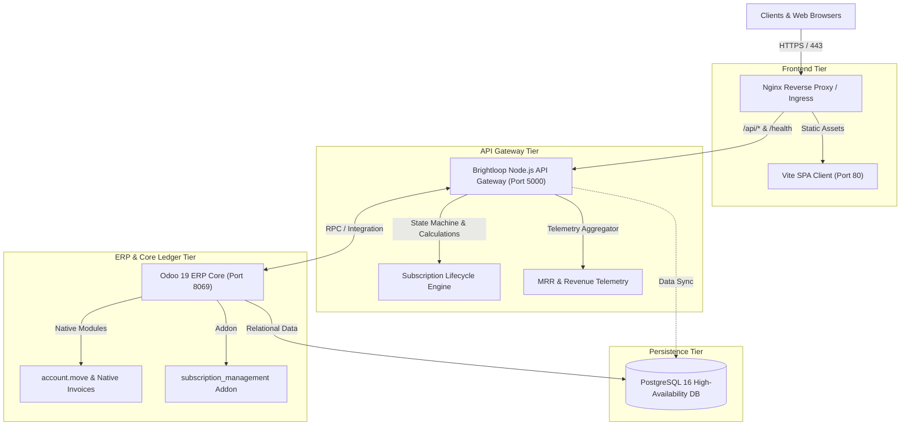

# Brightloop Enterprise Subscription Management — Production Deployment Guide

This guide describes the production deployment, infrastructure architecture, environment configurations, and operational procedures for the Brightloop Billing & Subscription Management Platform.

---

## 🏛️ System Architecture Topology

Brightloop is structured into a modern, decoupled, multi-tier enterprise architecture:



---

## 🖥️ System Requirements & Sizing

| Sizing Tier | Subscriptions Under Management | Minimum vCPU | Minimum RAM | Recommended Storage |
| :--- | :--- | :--- | :--- | :--- |
| **Starter / Staging** | < 5,000 active subs | 2 vCPU | 4 GB | 50 GB NVMe SSD |
| **Production Core** | 5,000 – 50,000 active subs | 4 vCPU | 8–16 GB | 150 GB NVMe SSD |
| **Enterprise High-Scale** | 50,000+ active subs | 8+ vCPU | 32 GB | 500 GB+ High-IOPS SSD |

**Prerequisites:**
- Linux (Ubuntu 22.04 LTS / 24.04 LTS recommended) or Windows Server
- Docker Engine 24.0+ & Docker Compose v2.20+ (for containerized deployments)
- Node.js 20 LTS or 22 LTS (for bare-metal backend)
- Python 3.10+ & PostgreSQL 16 (for bare-metal Odoo)

---

## 🐳 Deployment Method 1: Docker Compose (Recommended)

The easiest and most reproducible method is using Docker Compose. It provisions PostgreSQL 16, Odoo 19, the Node.js API Gateway, and the Nginx-powered Frontend SPA client in an isolated bridge network.

### Step 1: Clone and Configure Environment
```bash
git clone https://github.com/brightloop/Subscription-Management-System.git
cd Subscription-Management-System

# Generate environment configuration
cp .env.example .env
```

Review and adjust variables in `.env`:
```ini
POSTGRES_USER=odoo
POSTGRES_PASSWORD=generate_a_secure_password_here
POSTGRES_DB=postgres
POSTGRES_PORT=5432

ODOO_PORT=8069
BACKEND_PORT=5000
FRONTEND_PORT=3000
NODE_ENV=production
```

### Step 2: One-Click Automated Deployment
Run the automated deployment script:

**Linux / macOS:**
```bash
chmod +x deploy.sh
./deploy.sh
```

**Windows PowerShell:**
```powershell
.\deploy.ps1
```

Or manually with Docker Compose:
```bash
# Build custom containers
docker compose build --no-cache

# Start the stack in background
docker compose up -d

# Verify running containers
docker compose ps
```

### Step 3: Verify Service Health
```bash
# Check Backend API Gateway
curl -f http://localhost:5000/health

# Check Frontend SPA Client
curl -I http://localhost:3000/

# Check Odoo ERP Instance
curl -I http://localhost:8069/web/login
```

---

## 🛠️ Deployment Method 2: Bare-Metal / Systemd Service

For bare-metal production environments with separate servers:

### 1. Backend API Gateway (PM2 or Systemd)
```bash
cd backend
npm ci --omit=dev
cp .env.example .env
```

Create a systemd unit `/etc/systemd/system/brightloop-backend.service`:
```ini
[Unit]
Description=Brightloop Subscription API Gateway
After=network.target postgresql.service

[Service]
Type=simple
User=brightloop
WorkingDirectory=/opt/brightloop/backend
ExecStart=/usr/bin/node src/server.js
Restart=always
RestartSec=10
StandardOutput=syslog
StandardError=syslog
SyslogIdentifier=brightloop-backend
EnvironmentFile=/opt/brightloop/backend/.env

[Install]
WantedBy=multi-user.target
```

Enable and start:
```bash
sudo systemctl daemon-reload
sudo systemctl enable --now brightloop-backend
```

### 2. Frontend Production Build & Nginx
```bash
cd frontend
npm ci
npm run build
```
Copy `dist/` to `/var/www/brightloop-frontend` and configure your system Nginx to serve the directory using `frontend/nginx.conf`.

---

## 🔒 Security Hardening & SSL/TLS Configuration

In production, all public traffic must be encrypted via HTTPS (TLS 1.3).

### Let's Encrypt / Certbot Setup
```bash
sudo apt update && sudo apt install -y certbot python3-certbot-nginx
sudo certbot --nginx -d billing.yourcompany.com
```

### Recommended TLS Nginx Snippet
```nginx
server {
    listen 443 ssl http2;
    server_name billing.yourcompany.com;

    ssl_certificate /etc/letsencrypt/live/billing.yourcompany.com/fullchain.pem;
    ssl_certificate_key /etc/letsencrypt/live/billing.yourcompany.com/privkey.pem;
    ssl_protocols TLSv1.2 TLSv1.3;
    ssl_ciphers HIGH:!aNULL:!MD5;
    
    # HSTS Policy
    add_header Strict-Transport-Security "max-age=31536000; includeSubDomains; preload" always;

    location / {
        proxy_pass http://127.0.0.1:3000;
        proxy_set_header Host $host;
        proxy_set_header X-Forwarded-Proto https;
    }
}
```

---

## 💾 Database Backup & Disaster Recovery

### Automated Nightly PostgreSQL Backup
Create `/etc/cron.daily/backup-brightloop-pg`:
```bash
#!/bin/bash
BACKUP_DIR="/var/backups/brightloop/db"
TIMESTAMP=$(date +"%Y%m%d_%H%M%S")
mkdir -p "$BACKUP_DIR"

docker exec -t brightloop-postgres pg_dump -U odoo -F c -b -v -f "/var/lib/postgresql/data/backup_${TIMESTAMP}.dump" postgres
mv /var/lib/docker/volumes/brightloop-db-data/_data/backup_${TIMESTAMP}.dump "$BACKUP_DIR/"

# Retain 14 days of backups
find "$BACKUP_DIR" -type f -mtime +14 -name "*.dump" -delete
```

### Restore Procedure
```bash
docker exec -i brightloop-postgres pg_restore -U odoo -d postgres --clean < /path/to/backup.dump
```

---

## 📈 Monitoring & Telemetry

### Monitoring Endpoints
- **Application Liveness/Readiness:** `GET http://localhost:5000/health`
- **SaaS Metric Telemetry:** `GET http://localhost:5000/api/analytics/overview`
- **Audit Event Log Stream:** `GET http://localhost:5000/api/organization/audit-logs`

